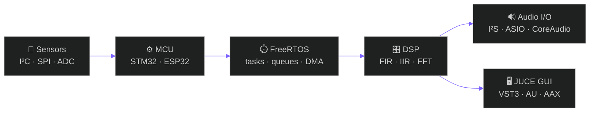

<!-- =====================================================================
     GITHUB PROFILE README v2 — Jaidev Kamboj
     Uses GitHub-native features: alerts, Mermaid, <picture> dark/light,
     collapsible <details>, tables, task lists.
     Palette: teal #00D4AA · violet #7B61FF · orange #FF6B35 · bg #0D1117
     Search "TODO" for the spots you must fill in.
     ===================================================================== -->

<a name="top"></a>

<div align="center">


<br>

<a href="mailto:jaidevkamboj4g@gmail.com"></a>
<a href="https://www.linkedin.com/in/jai-dev-wordpress/"></a>
<a href="https://github.com/jaidevkamboj?tab=repositories"></a>
<!-- TODO: replace YOUR_PORTFOLIO_URL with your real portfolio, or delete this line -->
<a href="YOUR_PORTFOLIO_URL"></a>

<br><br>


<br><br>

<a href="#-about"><kbd>&nbsp;👋 About&nbsp;</kbd></a>
<a href="#-what-i-do"><kbd>&nbsp;🎯 What I Do&nbsp;</kbd></a>
<a href="#-tech-stack"><kbd>&nbsp;🧰 Stack&nbsp;</kbd></a>
<a href="#-featured-projects"><kbd>&nbsp;🚀 Projects&nbsp;</kbd></a>
<a href="#-skills"><kbd>&nbsp;🧠 Skills&nbsp;</kbd></a>
<a href="#-github-stats"><kbd>&nbsp;📈 Stats&nbsp;</kbd></a>
<a href="#-contact"><kbd>&nbsp;🤝 Contact&nbsp;</kbd></a>

</div>

<br>

> [!TIP]
> **Open to work** in Embedded Software, Firmware, C++ Engineering, RTOS, Robotics / IoT / UAV, and DSP & Audio Software. [Say hello ↓](#-contact)

<br>

<!-- ============================ ABOUT ============================ -->

## 👋 About

<table>
<tr>
<td width="60%" valign="top">

I build **reliable, efficient, performance-oriented software** for embedded and intelligent systems, from bare-metal firmware to real-time audio.

I like problems where software, hardware and signal processing meet, and where every microsecond and every byte counts.

```cpp
// whoami.cpp
struct Engineer {
    const char* name  = "Jaidev Kamboj";
    const char* role  = "Embedded Software Engineer";
    const char* focus = "Firmware · Real-Time · DSP & Audio";
    const char* tools = "C/C++ · STM32 · ESP32 · FreeRTOS · JUCE";
    bool openToWork   = true;
};
```

</td>
<td width="40%" valign="top">

**⚡ Quick facts**

| | |
|:--|:--|
| 🎓 **Education** | B.Sc. IT, Kurukshetra University |
| 📍 **Based in** | Haryana, India |
| 💼 **Role** | Embedded / Audio Software Engineer |
| 🔧 **Core** | C · C++ · JUCE · FreeRTOS |
| 📡 **Targets** | STM32 · ESP32 · RISC-V |
| 🎛️ **Plugins** | VST3 · AU · AAX |

</td>
</tr>
</table>

<br>

<!-- ========================= WHAT I DO ========================= -->

## 🎯 What I Do

<table>
<tr>
<td width="33%" valign="top" align="center">

### ⚙️
### Embedded & Firmware
ARM Cortex-M, STM32, ESP32, RISC-V and Embedded Linux. Drivers, RTOS design, bootloaders and OTA, sensor integration and protocols.

</td>
<td width="33%" valign="top" align="center">

### 🎛️
### DSP & Audio
Real-time audio apps and plugins in JUCE and modern C++. Low-latency processing, efficient algorithms, professional interfaces.

</td>
<td width="33%" valign="top" align="center">

### 🤖
### Robotics & IoT
Motor and actuator control, PID loops, sensor fusion basics, UAV/drone concepts, connected devices over Wi-Fi, BLE and MQTT.

</td>
</tr>
</table>

**How the pieces connect: from sensor to sound**



<br>

<!-- ========================= TECH STACK ========================= -->

## 🧰 Tech Stack

<table>
<tr>
<td width="150" valign="middle"><b>💻 Languages<br>& Tools</b></td>
<td>

</td>
</tr>
<tr>
<td valign="middle"><b>⚙️ Embedded</b></td>
<td>


</td>
</tr>
<tr>
<td valign="middle"><b>🎛️ Audio & DSP</b></td>
<td>


</td>
</tr>
<tr>
<td valign="middle"><b>🌐 Domains</b></td>
<td>


</td>
</tr>
</table>

<br>

<!-- ===================== FEATURED PROJECTS ===================== -->

## 🚀 Featured Projects

<!-- TODO: put a screenshot in each card, e.g.  placed above the title,
     and link each title to its repo: <a href="https://github.com/jaidevkamboj/REPO_NAME">…</a> -->

<table>
<tr>
<td width="50%" valign="top">

#### 🎚️ Parametric Equalizer
Surgical 8-band EQ built for mastering work.


</td>
<td width="50%" valign="top">

#### 🔊 Dynamics Compressor
Transparent compression with character.


</td>
</tr>
<tr>
<td width="50%" valign="top">

#### 📊 Real-Time Analyzer
Professional spectrum and spectrogram display.


</td>
<td width="50%" valign="top">

#### 🌊 Studio Reverb
From intimate rooms to infinite halls.


</td>
</tr>
</table>

<!-- TODO (optional): GitHub-style repo cards. Replace REPO_NAME with real repo names, then uncomment.
<div align="center">
<a href="https://github.com/jaidevkamboj/REPO_NAME"></a>
<a href="https://github.com/jaidevkamboj/REPO_NAME_2"></a>
</div>
-->

<details>
<summary><b>📁 More projects (5)</b></summary>
<br>

| Project | Description | Stack |
|:--|:--|:--|
| 🎧 **DJ Mixer Pro** | Multi-deck DJ software with real-time effects, BPM detection and waveform display | `JUCE` `C++` `OpenGL` |
| 🔈 **Crown XTi DSP Emulator** | Amplifier DSP with crossover, limiter, delay and EQ matching the Crown XTi architecture | `JUCE` `MATLAB` |
| ⏱️ **Multi-Tap Delay** | Creative delay with up to 16 taps, filters and per-tap modulation | `JUCE DSP` `C++` |
| 🎵 **Media Player** | Audio/video player with playlist, visualization and format support | `JUCE` `FFmpeg` |
| 📡 **Live Sound Processor** | PA management: crossover, graphic EQ, delay, limiter | `JUCE` `MATLAB` |

</details>

<br>

<!-- ============================ SKILLS ============================ -->

## 🧠 Skills

<details open>
<summary><b>⚙️ Firmware & Real-Time</b> &nbsp;·&nbsp; <b>📡 Hardware Interfacing</b> &nbsp;·&nbsp; <b>🤖 Robotics</b></summary>
<br>

<table>
<tr>
<td width="33%" valign="top">

**Firmware & Real-Time**
- Bare-metal, HAL/LL drivers
- Interrupts, DMA, timers
- FreeRTOS tasks, queues, mutexes
- Deterministic scheduling
- Bootloaders & OTA updates
- Low-power, memory-constrained design
- JTAG/SWD debugging

</td>
<td width="33%" valign="top">

**Hardware Interfacing**
- UART, SPI, I²C, CAN
- ADC, DAC, PWM, GPIO
- I²S digital audio
- Wi-Fi, BLE, MQTT (ESP32)
- Sensor integration

</td>
<td width="33%" valign="top">

**Robotics & Devices**
- Motor & actuator control
- PID control loops
- Sensor fusion basics
- Flight-controller concepts
- Hardware–software co-design

</td>
</tr>
</table>

</details>

<details open>
<summary><b>💻 C++ & Engineering</b> &nbsp;·&nbsp; <b>🎛️ DSP & Audio</b> &nbsp;·&nbsp; <b>📊 MATLAB</b></summary>
<br>

<table>
<tr>
<td width="33%" valign="top">

**C++ & Engineering**
- Modern C++ (11/14/17/20)
- RAII, templates, `constexpr`
- Move semantics & concurrency
- CMake & cross-compilation
- Git workflow & code review
- Linux development
- Python scripting & automation

</td>
<td width="33%" valign="top">

**DSP & Audio**
- FIR/IIR filter design
- FFT analysis (FFTW)
- Dynamics, convolution, pitch detection
- VST3 / AU / AAX architecture
- Thread-safe real-time audio pipelines
- SIMD optimization

</td>
<td width="33%" valign="top">

**MATLAB Workflow**
- Signal Processing & Audio Toolboxes
- Filter Designer
- Algorithm prototyping
- Test bench creation
- Simulink & C code generation
- Data visualization

</td>
</tr>
</table>

</details>

<br>

<!-- ========================= GITHUB STATS ========================= -->

## 📈 GitHub Stats

<div align="center">

<picture>
  <source media="(prefers-color-scheme: dark)" srcset="https://github-readme-stats.vercel.app/api?username=jaidevkamboj&show_icons=true&theme=tokyonight&include_all_commits=true&count_private=true&hide_border=true&bg_color=0D1117&title_color=00D4AA&icon_color=7B61FF&text_color=ffffff&ring_color=00D4AA">
  <source media="(prefers-color-scheme: light)" srcset="https://github-readme-stats.vercel.app/api?username=jaidevkamboj&show_icons=true&include_all_commits=true&count_private=true&hide_border=true&bg_color=ffffff&title_color=009E80&icon_color=7B61FF&text_color=24292f&ring_color=00D4AA">
  
</picture>
<picture>
  <source media="(prefers-color-scheme: dark)" srcset="https://github-readme-stats.vercel.app/api/top-langs/?username=jaidevkamboj&layout=compact&theme=tokyonight&hide_border=true&bg_color=0D1117&title_color=00D4AA&text_color=ffffff&langs_count=6">
  <source media="(prefers-color-scheme: light)" srcset="https://github-readme-stats.vercel.app/api/top-langs/?username=jaidevkamboj&layout=compact&hide_border=true&bg_color=ffffff&title_color=009E80&text_color=24292f&langs_count=6">
  
</picture>

</div>

<details>
<summary><b>🔥 Streak & contribution activity</b></summary>
<br>

<div align="center">


</div>

</details>

<br>

<!-- ============================ CONTACT ============================ -->

## 🤝 Contact

> [!NOTE]
> Hiring for embedded, firmware or audio software work, or want to collaborate on a JUCE / DSP project? Email is the fastest way to reach me.

<div align="center">

<a href="mailto:jaidevkamboj4g@gmail.com"></a>
<a href="https://www.linkedin.com/in/jai-dev-wordpress/"></a>

<br><br>

<!-- Requires the snake GitHub Action; remove this image if you haven't set it up -->


<sub>Building reliable systems, from firmware to audio · <a href="#top">Back to top ↑</a></sub>

</div>
