<!-- =====================================================================
     GITHUB PROFILE README v5 — Jaidev Kamboj
     Design goals: clear hierarchy · scannable in 10 seconds · dark/light safe
     Palette: teal #00D4AA · violet #7B61FF · orange #FF6B35 · bg #0D1117
     Search "TODO" for the spots you must verify before publishing.
     Place this file in the repo named exactly like your username: jaidevkamboj/jaidevkamboj
     Put the four SVG illustrations in an /assets folder next to this file.
     ===================================================================== -->

<a name="top"></a>

<div align="center">


<br><br>

<a href="mailto:jaidevkamboj4g@gmail.com"></a>
<a href="https://www.linkedin.com/in/jaidevkamboj/"></a>
<a href="https://jaidevkamboj.github.io"></a>
<a href="https://github.com/jaidevkamboj?tab=repositories"></a>

<br><br>


<br><br>

<a href="#-about"><kbd>&nbsp;👋 About&nbsp;</kbd></a>
<a href="#-focus-areas"><kbd>&nbsp;🎯 Focus&nbsp;</kbd></a>
<a href="#-tech-stack"><kbd>&nbsp;🧰 Stack&nbsp;</kbd></a>
<a href="#-skill-matrix"><kbd>&nbsp;📊 Matrix&nbsp;</kbd></a>
<a href="#-featured-projects"><kbd>&nbsp;🚀 Projects&nbsp;</kbd></a>
<a href="#-dsp-showcase"><kbd>&nbsp;🧮 DSP&nbsp;</kbd></a>
<a href="#-engineering-practices"><kbd>&nbsp;🛠️ Practices&nbsp;</kbd></a>
<a href="#-github-stats"><kbd>&nbsp;📈 Stats&nbsp;</kbd></a>
<a href="#-contact"><kbd>&nbsp;🤝 Contact&nbsp;</kbd></a>

</div>

<br>

> [!TIP]
> **Open to engineering and R&D roles across India** — Embedded Software · Firmware · RTOS · C++ · Robotics / IoT / UAV · DSP & Audio. [Say hello ↓](#-contact)


<!-- ============================ ABOUT ============================ -->

## 👋 About

<table>
<tr>
<td width="58%" valign="top">

I build **reliable, efficient, performance-oriented software** for embedded and intelligent systems — from bare-metal firmware to real-time audio.

I enjoy problems where **software, hardware and signal processing meet**, and where every microsecond and every byte counts.

```cpp
// whoami.cpp
struct Engineer {
    const char* name  = "Jaidev Kamboj";
    const char* role  = "Embedded Software Engineer";
    const char* focus = "Firmware · Real-Time · DSP & Audio";
    const char* tools = "C/C++ · STM32 · ESP32 · FreeRTOS · JUCE";
    const char* ethos = "Deterministic · Testable · Measured";
    bool openToWork   = true;
};
```

</td>
<td width="42%" valign="top">

**⚡ At a glance**

| | |
|:--|:--|
| 💼 **Role** | Embedded / Audio Software Engineer |
| 🔧 **Core** | C · C++ · JUCE · FreeRTOS |
| 📡 **Targets** | STM32 · ESP32 · Cortex-M · RISC-V |
| 🎛️ **Plugins** | VST3 · AU · AAX |
| 🎓 **Education** | B.Sc. IT, Kurukshetra University |
| 📍 **Based in** | Haryana, India |
| 🧭 **Seeking** | Embedded · Firmware · R&D |

</td>
</tr>
</table>


<!-- ========================= FOCUS AREAS ========================= -->

## 🎯 Focus Areas

<table>
<tr>
<td width="33%" valign="top" align="center">

### ⚙️ Embedded & Firmware

ARM Cortex-M, STM32, ESP32, RISC-V and Embedded Linux. Drivers, startup code and linker scripts, RTOS design, bootloaders and OTA, sensors and protocols.

<sub><b>C · C++ · HAL/LL · FreeRTOS</b></sub>

</td>
<td width="33%" valign="top" align="center">

### 🎛️ DSP & Audio

Real-time audio apps and plugins in JUCE and modern C++. Low-latency, allocation-free processing, efficient algorithms and professional interfaces.

<sub><b>JUCE · DSP · VST3 / AU / AAX</b></sub>

</td>
<td width="33%" valign="top" align="center">

### 🤖 Robotics & IoT

Motor and actuator control, PID loops, sensor fusion, UAV / drone concepts, and connected devices over Wi-Fi, BLE and MQTT.

<sub><b>PID · IMU · BLE · MQTT</b></sub>

</td>
</tr>
</table>

**From sensor to sound — how the pieces connect**

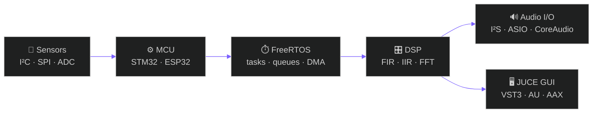


<!-- ========================= TECH STACK ========================= -->

## 🧰 Tech Stack

<div align="center">

<br>

</div>

<br>

<table>
<tr>
<td width="140" valign="middle"><b>⚙️ Embedded</b></td>
<td>


</td>
</tr>
<tr>
<td valign="middle"><b>🎛️ Audio & DSP</b></td>
<td>


</td>
</tr>
<tr>
<td valign="middle"><b>🔬 Debug & Test</b></td>
<td>


</td>
</tr>
<tr>
<td valign="middle"><b>🏗️ Build & CI</b></td>
<td>


</td>
</tr>
<tr>
<td valign="middle"><b>🌐 Domains</b></td>
<td>


</td>
</tr>
</table>


<!-- ========================= SKILL MATRIX ========================= -->

## 📊 Skill Matrix

<!-- TODO: adjust levels so they match your real experience. Honest levels read better to hiring managers. -->

| Area | Level | What I actually do with it |
|:--|:--:|:--|
| **C / C++ (11 → 20)** |  | RAII, templates, `constexpr`, move semantics, lock-free patterns |
| **Firmware (STM32 / ESP32)** |  | HAL/LL/CMSIS, startup & linker scripts, DMA, interrupts, low power |
| **JUCE / Audio plugins** |  | VST3 / AU / AAX, `AudioProcessorValueTreeState`, real-time-safe GUI ↔ DSP |
| **C/C++ R&D & prototyping** |  | MATLAB → C++ ports, benchmarking, numerical accuracy |
| **FreeRTOS / RTOS design** |  | Tasks, queues, semaphores, ISR-safe APIs, priority inversion |
| **DSP algorithms** |  | Biquads, FIR/IIR, FFT, convolution, dynamics, oversampling |
| **Communication protocols** |  | UART, SPI, I²C, CAN, I²S, BLE, MQTT |
| **Debugging & measurement** |  | SWD/JTAG, GDB, HardFault analysis, logic analyzer, scope |
| **Python tooling** |  | Test scripts, data analysis, serial/log tools, build helpers |
| **Git / CMake / CI** |  | Branching workflows, reproducible builds, GitHub Actions |
| **Embedded Linux** |  | Linux dev, drivers & device-tree concepts, cross-compilation |
| **RISC-V** |  | Toolchains, ISA fundamentals, bring-up basics |
| **Robotics / UAV** |  | PID, sensor-fusion basics, motor control, flight-controller concepts |

<sub>🟢 Advanced = daily use &nbsp;·&nbsp; 🟣 Proficient = comfortable on real projects &nbsp;·&nbsp; 🟠 Working = hands-on, still deepening</sub>


<!-- ===================== FEATURED PROJECTS ===================== -->

## 🚀 Featured Projects

<!-- TODO: add a screenshot above each title (e.g. )
     and link each title to its repo: <a href="https://github.com/jaidevkamboj/REPO_NAME">…</a>
     Remove any project you don't want to show publicly. -->

<table>
<tr>
<td width="50%" valign="top">

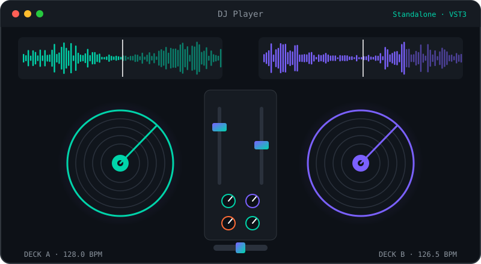

#### 🎧 DJ Player
Flagship JUCE-based DJ application, shipping as Standalone and VST3, with real-time audio, waveform display and a custom interface.


</td>
<td width="50%" valign="top">

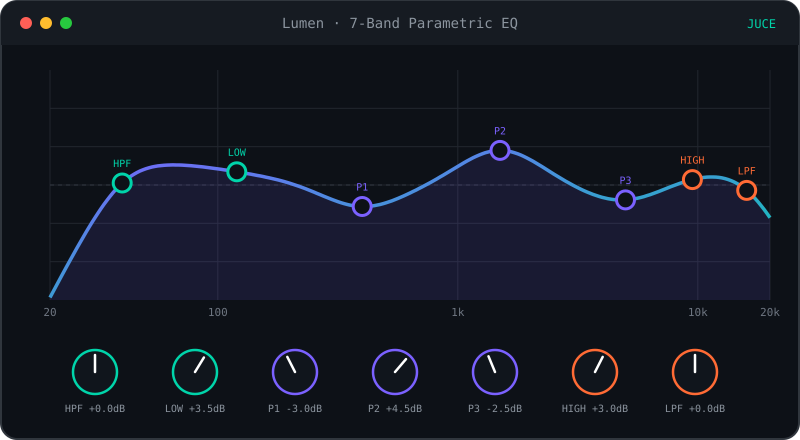

#### 💡 Lumen — 7-Band Parametric EQ
HPF, low shelf, three peaking bands, high shelf and LPF with a custom-drawn control set (knobs, combo boxes, toggles) and a consistent visual theme.


</td>
</tr>
<tr>
<td width="50%" valign="top">

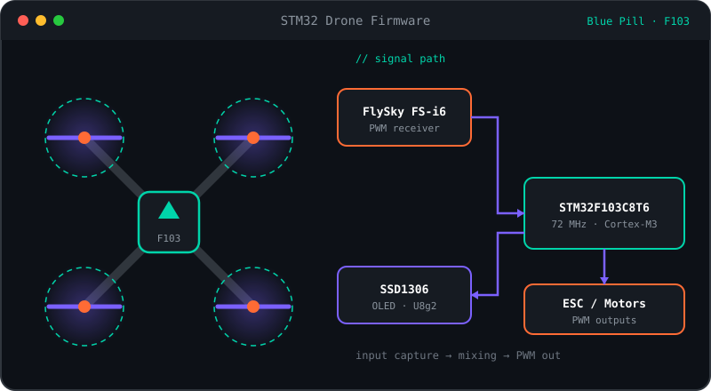

#### 🚁 STM32 Drone Firmware
Flight-controller experiments on an STM32F103C8T6 "Blue Pill" with an SSD1306 OLED status display and FlySky FS-i6 PWM receiver input.


</td>
<td width="50%" valign="top">

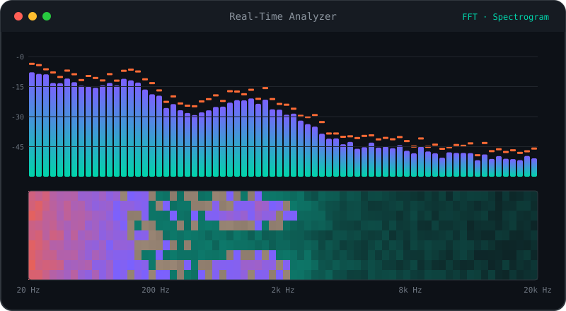

#### 📊 Real-Time Analyzer
Spectrum and spectrogram display with overlapped, windowed FFT and a lock-free hand-off from the audio thread to the GUI.


</td>
</tr>
<tr>
<td width="50%" valign="top">

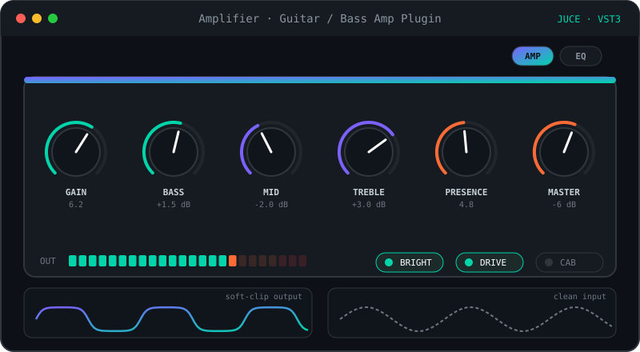

#### 🎸 Amplifier — Amp Mode
JUCE amplifier plugin with gain, bass / mid / treble, presence and master controls, drive and bright switches, a soft-clip stage and an output meter.


</td>
<td width="50%" valign="top">

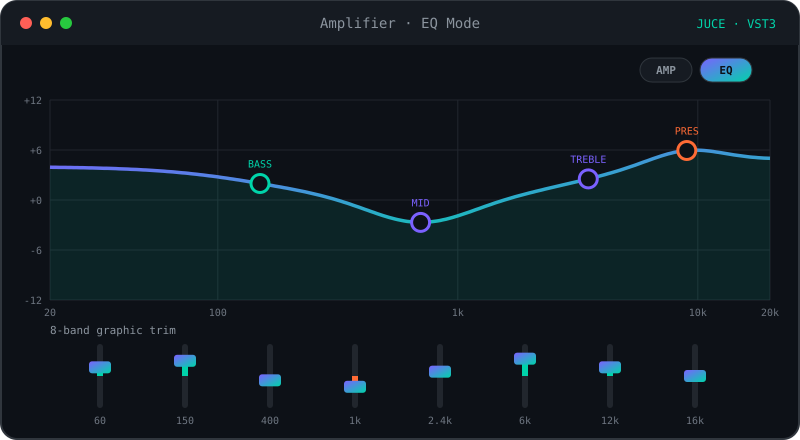

#### 🎚️ Amplifier — EQ Mode
Switchable EQ view on the same plugin: a live tone-stack response curve with draggable bass, mid, treble and presence nodes, plus an 8-band graphic trim.


</td>
</tr>
</table>

<details>
<summary><b>📁 More projects</b></summary>
<br>

| Project | Description | Stack |
|:--|:--|:--|
| 🎚️ **Parametric Equalizer** | 8-band mastering EQ, cascaded biquads with smoothed parameters | `JUCE` `C++` |
| 🔊 **Dynamics Compressor** | Detector design, ballistics, soft knee and lookahead | `JUCE` `C++` |
| 🌊 **Studio Reverb** *(in development)* | Diffusion networks, modulated delay lines, damping filters | `JUCE` `C++` |
| 🔈 **Crown XTi DSP Emulator** | Amplifier DSP: crossover, limiter, delay and EQ matching the Crown XTi architecture | `JUCE` `MATLAB` |
| ⏱️ **Multi-Tap Delay** | Up to 16 taps with filters and per-tap modulation | `JUCE DSP` `C++` |
| 🎵 **Media Player** | Audio/video player with playlist, visualization and format support | `JUCE` `FFmpeg` |
| 📡 **Live Sound Processor** | PA management: crossover, graphic EQ, delay, limiter | `JUCE` `MATLAB` |

</details>

<!-- TODO (optional): pinned-repo cards. Replace REPO_NAME, then uncomment.
<div align="center">
<a href="https://github.com/jaidevkamboj/REPO_NAME"></a>
</div>
-->


<!-- ============================ DSP SHOWCASE ============================ -->

## 🧮 DSP Showcase

*The signal-processing building blocks behind my plugins and firmware — prototyped in MATLAB / Python, then ported to allocation-free C++.*

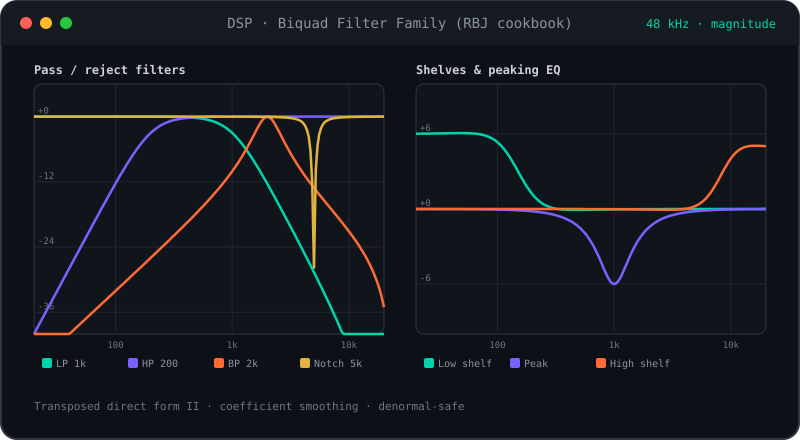

<table>
<tr>
<td width="50%" valign="top">

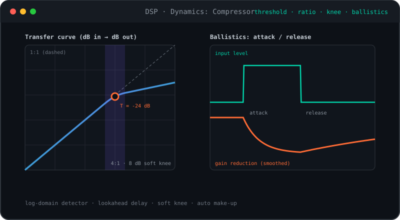

</td>
<td width="50%" valign="top">

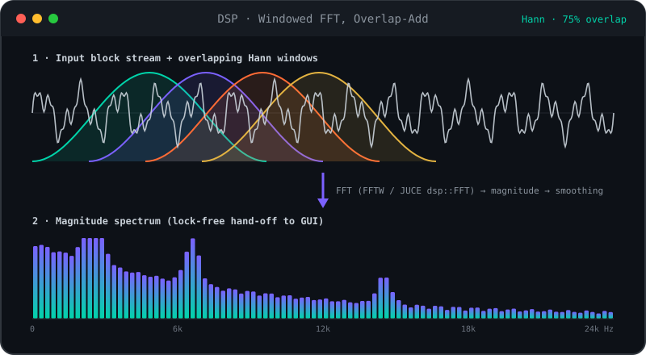

</td>
</tr>
</table>

**A typical plugin signal chain**

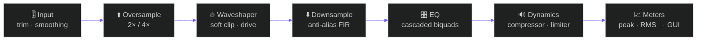

<details open>
<summary><b>🧰 DSP toolbox</b></summary>
<br>

| Block | Technique | Real-time notes |
|:--|:--|:--|
| **Filters** | RBJ biquads, TDF-II / TPT-SVF, FIR, linear-phase FIR | Coefficient smoothing, denormal-safe, stable under automation |
| **EQ** | Cascaded bands: HPF, shelves, peaks, LPF | Per-band bypass, response curve computed off the audio thread |
| **Dynamics** | Compressor, limiter, gate | Log-domain detector, soft knee, attack/release ballistics, lookahead |
| **Nonlinear** | Waveshaping, saturation, amp stages | Oversampling plus anti-alias filtering to tame aliasing |
| **Spectral** | Windowed FFT, overlap-add, spectrogram | Pre-planned FFT, lock-free hand-off to the GUI |
| **Convolution** | Direct, FFT, partitioned | Latency vs CPU trade-offs, uniform partitions |
| **Time-based** | Delay lines, multi-tap, reverb networks | Fractional delay interpolation, modulated taps, damping filters |
| **Analysis** | Peak / RMS / LUFS-style metering, pitch detection | Ballistics, ring-buffered histories |

</details>

<details>
<summary><b>💻 Real-time-safe biquad (C++)</b></summary>
<br>

```cpp
// Transposed direct form II — 2 state variables, no allocation, no branches in the loop
struct Biquad {
    float b0 = 1, b1 = 0, b2 = 0, a1 = 0, a2 = 0;   // a0 normalised to 1
    float z1 = 0, z2 = 0;

    inline float process (float x) noexcept {
        const float y = b0 * x + z1;
        z1 = b1 * x - a1 * y + z2;
        z2 = b2 * x - a2 * y;
        return y;
    }
};

void processBlock (juce::AudioBuffer<float>& buffer, juce::MidiBuffer&) override {
    juce::ScopedNoDenormals noDenormals;              // flush denormals on the audio thread
    for (int n = 0; n < buffer.getNumSamples(); ++n) {
        const float g = gainSmoothed.getNextValue();   // click-free parameter changes
        for (int ch = 0; ch < buffer.getNumChannels(); ++ch) {
            auto* x = buffer.getWritePointer (ch);
            x[n] = filters[ch].process (x[n] * g);
        }
    }
}
```

</details>

<details>
<summary><b>🔬 From paper to plugin — my DSP workflow</b></summary>
<br>

1. **Prototype** the algorithm in MATLAB or Python and plot the response.
2. **Create golden vectors** — impulse, sine sweep, noise and edge cases.
3. **Port to C++** with fixed buffers and no allocation in the hot path.
4. **Validate** the C++ output against the golden reference with a numeric tolerance.
5. **Profile** worst-case CPU per block, then optimise (SIMD, oversampling ratio, FFT size).
6. **Listen and measure** in a real host before release.

</details>


<!-- ============================ SKILLS ============================ -->

## 🧠 Skills in Depth

<details open>
<summary><b>⚙️ Firmware & Real-Time</b> &nbsp;·&nbsp; <b>📡 Hardware Interfacing</b> &nbsp;·&nbsp; <b>🤖 Robotics</b></summary>
<br>

<table>
<tr>
<td width="33%" valign="top">

**Firmware & Real-Time**
- Bare-metal, HAL/LL/CMSIS drivers
- Startup code, vector tables, linker scripts
- NVIC priorities, DMA, timers
- FreeRTOS tasks, queues, mutexes, event groups
- ISR-safe APIs, priority inversion, deadlock avoidance
- WCET and stack-usage analysis
- Bootloaders, dual-bank OTA, signing, CRC checks
- Watchdogs, brown-out handling, fault recovery
- Low-power modes, memory-constrained design

</td>
<td width="33%" valign="top">

**Hardware Interfacing**
- UART, SPI, I²C, CAN
- USB (CDC / Audio class basics)
- ADC, DAC, PWM, GPIO, input capture
- I²S / TDM digital audio, codecs
- Wi-Fi, BLE (GATT), MQTT on ESP32
- Sensors: IMU, barometer, GPS, ToF, temperature
- Datasheets, schematics, timing diagrams
- Logic analyzer and oscilloscope debugging

</td>
<td width="33%" valign="top">

**Robotics & Devices**
- DC, BLDC, stepper and servo control
- PID loops, tuning and anti-windup
- Complementary filter, Kalman basics
- Attitude estimation from IMU data
- Flight-controller concepts, ESC / PWM signalling
- Telemetry and serial command protocols
- Hardware–software co-design

</td>
</tr>
</table>

</details>

<details>
<summary><b>💻 C++ & Engineering</b> &nbsp;·&nbsp; <b>🎛️ DSP & Audio</b> &nbsp;·&nbsp; <b>📊 MATLAB</b></summary>
<br>

<table>
<tr>
<td width="33%" valign="top">

**C++ & Engineering**
- Modern C++ (11/14/17/20)
- RAII, templates, `constexpr`, concepts
- Move semantics, smart pointers, ownership design
- `std::atomic`, memory ordering, lock-free SPSC queues
- Embedded C++ without exceptions / RTTI
- Memory pools, ring buffers, static allocation
- CMake presets, cross-compilation
- Git workflow, code review, semantic versioning

</td>
<td width="33%" valign="top">

**DSP & Audio**
- FIR / IIR design, biquad topologies
- FFT analysis (FFTW), windowing, overlap-add
- Fast and partitioned convolution
- Dynamics, delay, reverb, pitch detection
- Oversampling and anti-aliasing
- Parameter smoothing, denormal handling
- Peak / RMS / LUFS metering concepts
- VST3 / AU / AAX architecture, host automation
- SIMD optimization, cache-aware layout

</td>
<td width="33%" valign="top">

**MATLAB Workflow**
- Signal Processing and Audio Toolboxes
- Filter Designer, fixed-point analysis
- Algorithm prototyping before C++ port
- Test benches and golden references
- Simulink and C code generation
- Visualization and measurement scripts

</td>
</tr>
</table>

</details>

<details>
<summary><b>🔌 Protocols</b> &nbsp;·&nbsp; <b>🔐 Reliability</b> &nbsp;·&nbsp; <b>⚡ Performance</b></summary>
<br>

<table>
<tr>
<td width="33%" valign="top">

**Protocols & Connectivity**
- Custom framing: COBS / SLIP, CRC16/32
- Modbus RTU basics
- MQTT topics, QoS, retained messages
- BLE GATT services and characteristics
- OTA over Wi-Fi / BLE
- State-machine driven protocol stacks

</td>
<td width="33%" valign="top">

**Reliability & Security**
- Defensive coding, input validation
- MISRA C/C++ awareness
- clang-tidy, cppcheck
- ASan / UBSan on host builds
- Secure boot and signed-update concepts
- Graceful degradation, fail-safe states

</td>
<td width="33%" valign="top">

**Performance**
- DWT cycle counters and trace profiling
- Fixed-point vs floating-point trade-offs
- CMSIS-DSP and hardware FPU
- LTO, size/speed tuning
- Linker map and binary-size analysis
- Benchmarking and regression tracking

</td>
</tr>
</table>

</details>

<details>
<summary><b>🔬 R&D</b> &nbsp;·&nbsp; <b>🖥️ Platforms</b> &nbsp;·&nbsp; <b>🎨 Audio UI</b> &nbsp;·&nbsp; <b>🤝 Working Style</b></summary>
<br>

<table>
<tr>
<td width="33%" valign="top">

**R&D & Algorithms**
- Turning papers and specs into working C/C++
- MATLAB / Python prototype → optimized C++
- Numerical stability and precision analysis
- Real-time data structures
- Test vectors and golden-reference validation
- Technical documentation and design notes

</td>
<td width="33%" valign="top">

**Platforms & OS**
- Windows, macOS, Linux development
- Bare-metal and RTOS targets
- Embedded Linux user space, cross-compilation
- Threads, mutexes, condition variables, atomics
- ASIO, WASAPI, CoreAudio, ALSA, JACK
- DAW compatibility testing
- Cross-platform packaging with CMake

</td>
<td width="33%" valign="top">

**Audio UI & Visualization**
- JUCE `Component`, `LookAndFeel`, custom painting
- OpenGL waveform and spectrum rendering
- Meters, knobs, curves, spectrum displays
- Message-thread vs audio-thread separation
- Preset and parameter state (`ValueTree`)
- Responsive, resizable plugin UIs

</td>
</tr>
</table>

**Working style:** breaking hard hardware/software issues into measurable hypotheses · owning work from requirements to bring-up, test and release · readable commits and handover-ready docs · clear trade-off communication across hardware, firmware and DSP.

</details>


<!-- ===================== ENGINEERING PRACTICES ===================== -->

## 🛠️ Engineering Practices

*How I try to build software that still works at 3 a.m. in the field.*

<table>
<tr>
<td width="50%" valign="top">

**⏱️ Real-time rules I follow**

```cpp
// audio callback / ISR hot path
// ✘ no new / delete / malloc
// ✘ no locks, blocking I/O or logging
// ✘ no exceptions, no unbounded loops
// ✔ pre-allocate in prepare() / init()
// ✔ lock-free queues across threads
// ✔ smooth parameters, never jump them
// ✔ measure worst case, not average
```

</td>
<td width="50%" valign="top">

**🧪 Quality pipeline**

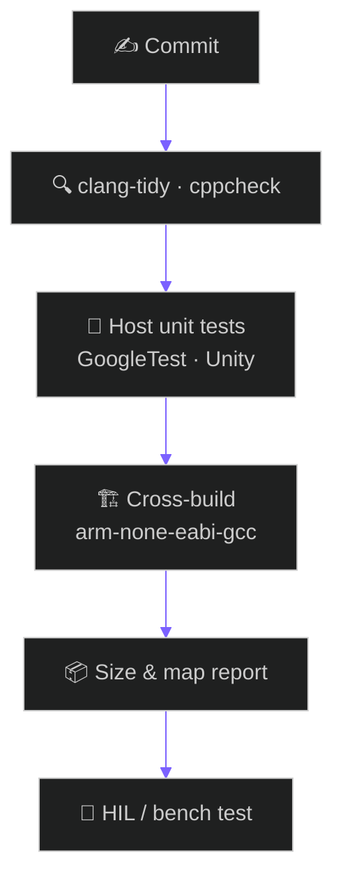

</td>
</tr>
</table>

<details>
<summary><b>📐 Design principles</b></summary>
<br>

- **Separate hardware from logic.** A thin HAL boundary lets the core run (and be tested) on a PC.
- **Static over dynamic.** Fixed-size buffers and pools beat the heap on constrained targets.
- **Explicit state machines** for protocols, power modes and error handling instead of tangled flags.
- **Measure first.** Cycle counters, scope toggles and trace before any optimization.
- **Fail safe.** Watchdogs, timeouts and defined fallback states for every external dependency.
- **Readable beats clever.** Document the *why* with Doxygen and short design notes.

</details>

<details>
<summary><b>🔬 Typical debugging workflow</b></summary>
<br>

1. Reproduce reliably, then shrink the failing case.
2. Check the physical layer first: power, clocks, pull-ups, signal integrity.
3. On a HardFault, inspect CFSR, HFSR, BFAR and the stacked PC.
4. Use GDB over SWD with watchpoints for corruption; trace for timing issues.
5. Add a regression test or assertion so the bug stays fixed.

</details>


<!-- ===================== TEACHING ===================== -->

## 🎓 Teaching


<!-- TODO: add the course link (Udemy / Gumroad / YouTube / etc.) and confirm the module and hour counts. -->

> [!NOTE]
> **C++ JUCE Audio Plugin Development Course** — 10 modules, 40+ hours, taking you from first project to a finished, host-ready VST3 plugin with real-time-safe DSP and a custom UI.


<!-- ===================== LEARNING ROADMAP ===================== -->

## 🌱 Currently Levelling Up

<!-- TODO: tick or edit these to match what you are actually working on. -->

- [x] Real-time audio plugins with JUCE (VST3 / AU / AAX)
- [x] FreeRTOS-based firmware on STM32 and ESP32
- [ ] Zephyr RTOS and devicetree-based firmware
- [ ] Rust for embedded (`embedded-hal`, Embassy)
- [ ] Embedded Linux: Yocto / Buildroot, kernel drivers
- [ ] Hardware-in-the-loop CI for firmware
- [ ] PX4 / ArduPilot internals for UAV work
- [ ] SIMD (NEON / AVX) optimized DSP kernels
- [ ] Machine learning on MCUs (TinyML, CMSIS-NN)


<!-- ========================= GITHUB STATS ========================= -->

## 📈 GitHub Stats

<div align="center">

<picture>
  <source media="(prefers-color-scheme: dark)" srcset="https://github-readme-stats.vercel.app/api?username=jaidevkamboj&show_icons=true&theme=tokyonight&include_all_commits=true&count_private=true&hide_border=true&bg_color=0D1117&title_color=00D4AA&icon_color=7B61FF&text_color=ffffff&ring_color=00D4AA">
  <source media="(prefers-color-scheme: light)" srcset="https://github-readme-stats.vercel.app/api?username=jaidevkamboj&show_icons=true&include_all_commits=true&count_private=true&hide_border=true&bg_color=ffffff&title_color=009E80&icon_color=7B61FF&text_color=24292f&ring_color=00D4AA">
  
</picture>
<picture>
  <source media="(prefers-color-scheme: dark)" srcset="https://github-readme-stats.vercel.app/api/top-langs/?username=jaidevkamboj&layout=compact&theme=tokyonight&hide_border=true&bg_color=0D1117&title_color=00D4AA&text_color=ffffff&langs_count=6">
  <source media="(prefers-color-scheme: light)" srcset="https://github-readme-stats.vercel.app/api/top-langs/?username=jaidevkamboj&layout=compact&hide_border=true&bg_color=ffffff&title_color=009E80&text_color=24292f&langs_count=6">
  
</picture>

<br>


</div>

<details>
<summary><b>🔥 Streak & contribution activity</b></summary>
<br>

<div align="center">


</div>

</details>


<!-- ============================ CONTACT ============================ -->

## 🤝 Contact

> [!IMPORTANT]
> Hiring for **embedded, firmware, C++ or audio software** work — or want to collaborate on a JUCE / DSP / robotics project? **Email is the fastest way to reach me.**

<div align="center">

<a href="mailto:jaidevkamboj4g@gmail.com"></a>
<a href="https://www.linkedin.com/in/jaidevkamboj/"></a>
<a href="https://jaidevkamboj.github.io"></a>

<br><br>

<!-- Requires the snake GitHub Action; remove this image if you haven't set it up -->


<sub>Building reliable systems, from firmware to audio &nbsp;·&nbsp; <a href="#top">Back to top ↑</a></sub>

</div>
